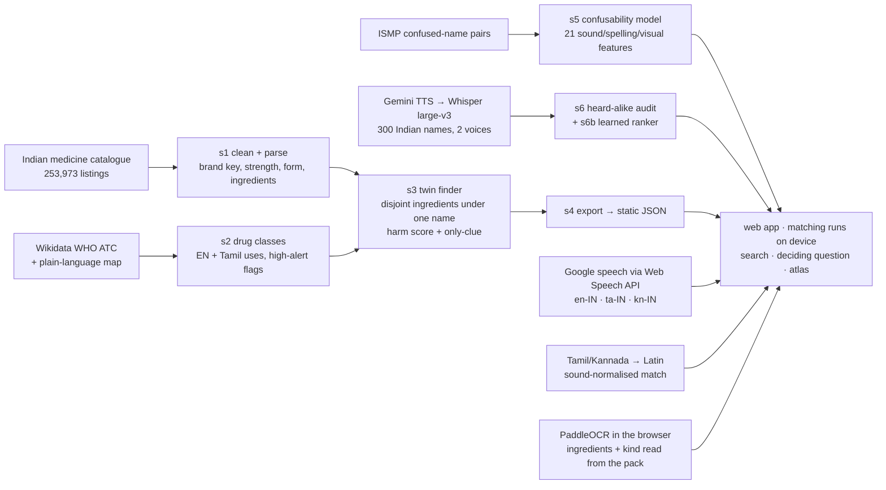

<div align="center">


# Twinpill

### One name. Two medicines. Caught.

**In India, one medicine name can mean two completely different drugs.**
Type, say or photograph a name: Twinpill shows every medicine it could be, and the one question that tells them apart.

[**Live app**](https://hannielvinu.github.io/TwinPill/) · [**Demo video**](https://youtu.be/L40GxcFT6XU) · [Twin Atlas](https://hannielvinu.github.io/TwinPill/#/atlas) · [Evidence](https://hannielvinu.github.io/TwinPill/#/evidence) · [Technical report](docs/REPORT.md)

</div>

---

## The problem in one line

**Acetam 650** is a paracetamol fever tablet. **Acetam 500** is levetiracetam, an epilepsy drug. Same name, two companies, both in the Indian catalogue. The only clue on the strip is one number.

India has no database of medicine brand names ([Lancet Regional Health – Southeast Asia, 2024](https://doaj.org/article/356f0b1c9fd84768a6350339f5a8ae45)). Most prescriptions are handwritten lists of brand names, and the Drugs Technical Advisory Board recommended banning different drugs under one name in January 2024. In July 2026 CDSCO opened a public consultation on brand-name extensions, and commentators note that it covers identical names only, not sound-alike or look-alike names ([SpicyIP, 2026](https://spicyip.com/2026/07/brand-name-extensions-by-pharma-may-finally-be-receiving-scrutiny.html); [Medical Dialogues](https://medicaldialogues.in/news/industry/pharma/cdsco/cdsco-examines-use-of-similar-pharma-brand-names-for-different-medicines-seeks-stakeholder-feedback-174507)).

**Who it is for:** pharmacists reading brand-only prescriptions, family members reading a name over the phone, elders ordering refills by voice, and e-pharmacies and hospitals that need a name-safety check.

## What we found (measured on 242,924 Indian listings)

| Finding | Count |
|---|---|
| Brand names used by **different companies** for medicines with **no shared ingredient** | **3,449** |
| Names one company reuses for unrelated medicines via suffixes (Medzole / Medzole-DSR style) | **2,977** |
| Twin names involving a **high-alert** medicine (sedatives, epilepsy, diabetes, opioids, blood thinners, cancer) | **588** |
| High-alert twins where the **printed number is the only clue** | **304** |
| Share of brand names used by 2+ companies that hide a cross-company twin | **42.0%** |

Real examples from the catalogue (click any of them in the app):

| Name | Meaning 1 | Meaning 2 | The only clue |
|---|---|---|---|
| **Acetam** | 650 mg · paracetamol (fever) | 500 mg · levetiracetam (epilepsy) | the number |
| **Adnil** | 5 mg · glibenclamide (diabetes) | 0.5 mg · clonazepam (sedative) | the number |
| **Olip** | eye drop · olopatadine (allergy) | tablet · olanzapine (antipsychotic) | the form |
| **Biopam** | tablet · clonazepam (sedative) | injection · pralidoxime (pesticide-poisoning antidote) | the form |
| **Zentra 100** | capsule SR · opioid painkiller | capsule · antifungal | the company name (and the letters "SR") |
| **Dolo** | Dolo 650 · paracetamol | Dolo Soft MR · nimesulide + tizanidine (other company) | the letters after the name |

## For people who cannot read the strip

Blind and low-vision people, elders without their glasses, anyone in a dim room: they cannot check the one number or word that separates two medicines with the same name. **Talk mode** (`#/talk`) is built for them:

- **One huge button.** The camera keeps looking, with a soft tick so you know it is working. It tells you what to do ("I can see writing, but not the name. Slowly turn the medicine to show the front") until it can read the name. No aiming, no photo to take.
- **It speaks the whole answer:** the medicine, its kind (tablet, injection, eye drops…), what it is for, what it contains, the twin warning, and the **expiry date, with a warning if it has expired**, in English, Tamil or Kannada. A vibration and a chime mark the moment it finds the medicine.
- **Say a name** instead, and **Say it again** to repeat the answer.
- Screen-reader friendly: every control has a spoken label for TalkBack and VoiceOver, there is a skip link straight to Talk mode, and all pages pass an automated **WCAG 2 A and AA** check (axe-core, 0 violations; [`results/accessibility.json`](results/accessibility.json)).

## What Twinpill does

1. **Type, say or snap** a medicine name, in **English, Tamil or Kannada**. Voice uses the browser's speech recognition (Google's engine in Chrome and Android, the same as Google voice typing). A name said or typed in Tamil or Kannada script is converted to Latin letters and matched by sound. Photo reading (PaddleOCR, in the browser) and all matching run on the device.

   **Snap a pack and it talks back.** The photo reader finds the brand, the ingredients printed on the pack and the kind of medicine (tablet, injection, eye drops, syrup…), works out which of the name's medicines this exact pack is, and says the answer out loud in English, Tamil or Kannada. It accepts a brand only when the pack backs it up (printed ingredients, or a brand standing on its own line), so a back-of-strip photo gives the ingredients instead of a guess.
2. Twinpill finds the brand, **plus every name a listener, a speech app or a hurried reader could land on instead**.
3. It groups everything sold under that name by active ingredient, in plain words ("fits (epilepsy)", not "antiepileptic"), in **English, Tamil or Kannada**.
4. It asks **the one question that splits the unrelated medicines**: the form, then the printed number, then the letters after the name, then the company. Tap the answer that matches the strip: the right medicine moves to the top and is read out loud.
5. The **Twin Atlas** ranks India's most dangerous name clashes for pharmacists, hospitals and the regulator.
6. When you speak, it shows **what the speech AI heard and what Twinpill found** ("add nil" → Adnil), so the correction is visible.
7. **Talk mode** for people who cannot read the strip (see above).
8. **Warn my family on WhatsApp:** one tap sends the warning and the deciding question in English, Tamil or Kannada.
9. **Works offline** after the first visit (a service worker caches the app and data), so it still works at a chemist with poor signal.

Twinpill never names the "right" drug. It shows what a name could mean so a person asks before they swallow.

## Why this is new

| Existing approach | What it does | What it misses |
|---|---|---|
| FDA POCA (USA) | Scores two US names you already have, for approving new names | No Indian brands; does not answer "what could this name be?" |
| E-pharmacy search (1mg, PharmEasy…) | Shows the product you clicked | Never warns that the name has an unrelated twin |
| CDSCO consultation (Jul 2026) | Asks about identical brand-name extensions | Sound-alikes, look-alikes and speech mishearings |
| Hospital LASA lists | Hand-made lists of a few dozen pairs | Not the 120,000+ Indian brand names |
| **Twinpill** | Every Indian brand name, all four clash types (same name, same family, sounds alike, misheard by speech AI), plus the single deciding question, in Tamil and Kannada | – |

## Architecture



**Stack:** Python (pandas, scikit-learn, LightGBM, rapidfuzz, jellyfish, matplotlib) for the pipeline; vanilla JavaScript, the Web Speech API and speech synthesis, and PaddleOCR (PP-OCRv4 on ONNX Runtime Web) for the app; static hosting on GitHub Pages. No server, no account, no tracking.

## AI / ML methods

- **Brand-key extraction:** the name a person would actually say ("New Triglucored", not "New"), using word-frequency filtering of generic first words.
- **Ingredient → class:** 1,643 ingredients mapped to WHO ATC codes via Wikidata plus a curated gap list (99.0% of products covered), then to plain-language uses in English, Tamil and Kannada.
- **Twin detection + harm score:** two products under one brand key with no shared ingredient. A truncation guard excludes products whose ingredient list may be incomplete, so every reported twin is checkable. A transparent 0–100 harm score adds points for a different purpose, a different body system, a high-alert medicine, the same route and form, and the same printed strength.
- **Indian-English phonetic key:** collapses spellings that sound identical at a chemist counter (ph/f, c/k/s, z/s/j, v/w, aspirated pairs, vowel drift). Identical in Python and JavaScript, and tested.
- **Confusability model:** logistic regression over 21 sound, spelling and handwriting features. It is trained on 440 real confused pairs from the ISMP List of Confused Drug Names against 1,320 never-reported pairs, and validated with name-grouped 5-fold cross-validation.
- **Heard-alike audit + learned ranker:** 300 Indian brand names are spoken by two synthetic voices and transcribed by Whisper large-v3. A ranker learns to recover the intended name from what speech AI wrote. It is trained on one voice and tested on the other.
- **Deciding question:** chooses the first attribute (form → number → letters after the name → company) whose values do not overlap between the unrelated meanings.

## Mathematics

Every formula below is what the code runs (file named after each). Worked example throughout: **Adnil**.

**1 · Brand key** (`pipeline/common.py`). A listing name $n$ is split into words $w_1 w_2 \dots$. The key is $w_1$, unless $w_1$ is a common English word (word frequency above a threshold: "new", "zen") and $w_2$ is not a number or a dosage form, in which case the key is $w_1\,w_2$ ("New Triglucored Forte Tablet" → `new triglucored`). All listings with the same key form one name $R$.

**2 · Twin** (`pipeline/s3_twins.py`). Group the products of $R$ by ingredient set $I(p)$. Two products $a, b$ are a **twin pair** when

$$I(a) \cap I(b) = \varnothing \quad\text{and}\quad \lnot\,\mathrm{inc}(a) \;\land\; \lnot\,\mathrm{inc}(b),$$

where $\mathrm{inc}(p)=1$ if the source may have cut $p$'s ingredient list short: $p$ prints more doses than it lists ingredients ("40/12.5/5" with two ingredients), or $p$ lists exactly two ingredients and lacks the molecule $m^{\star}$ found in at least half of the same company's $\geq 3$ products under $R$ (Telma-MCT keeps telmisartan). A name is a twin when at least one twin pair exists; *cross-company* when the pair's makers differ.

**3 · Harm score** (`harm_score`), for a twin pair $(a,b)$, capped at 100:

$$H(a,b)=\min\!\Big(100,\;35\,[\mathrm{ATC3}_a\cap\mathrm{ATC3}_b=\varnothing]+15\,[\mathrm{ATC1}_a\cap\mathrm{ATC1}_b=\varnothing]+30\,[\mathrm{HA}_a\lor\mathrm{HA}_b]+10\,[r_a=r_b]+5\,[r_a=r_b\land f_a=f_b]+5\,[f_a=f_b\land s_a=s_b]\Big)$$

($[\cdot]$ = 1 if true; ATC3/ATC1 = WHO therapeutic subgroup / body system; HA = ISMP high-alert class; $r$ route, $f$ form, $s$ printed strength.)
*Adnil:* glibenclamide (A10, alimentary) vs clonazepam (N03, nervous system): different purpose **+35**, different body system **+15**, clonazepam and glibenclamide are high-alert **+30**, both oral **+10**, both tablets **+5**, strengths differ (5 vs 0.5) **+0** → $H=95$, the value stored in `web/data/roots.json`.

**4 · The deciding question** (`only_clue`, `decidingQuestion`). For the unrelated groups $G_1..G_k$ of a name, ask the first attribute $x \in (\text{form}, \text{strength}, \text{letters after the name}, \text{company})$ whose value sets are pairwise disjoint, $x(G_i)\cap x(G_j)=\varnothing\ \forall i\neq j$. *Adnil:* both tablets (form fails); strengths $\{5, 2.5\}$ vs $\{0.5\}$ are disjoint → "What number is printed right after the name?"

**5 · Indian-English sound key** $\phi$ (`pipeline/phonetic.py`, mirrored in `web/js/phonetic.js`). Rewrite rules ph→f, gh/kh/bh/dh/th→g/k/b/d/t, c→s before e/i/y else k, q→k, x→ks, z/j→s, w→v, y→i, then drop repeated letters, a silent h after a consonant, and every vowel after the first letter. $\phi(\text{adnil})=\phi(\text{addnil})=$ `adnl`; $\phi(\text{acetam})=\phi(\text{acetum})=$ `astm`.

**6 · Confusability model** (`pipeline/features.py`, `s5_confusability.py`). For a name pair $(x,y)$, a 21-feature vector $\mathbf{v}$ (Levenshtein and Damerau ratios, Jaro-Winkler, bigram/trigram Dice, shared prefix/suffix, length difference, equality of $\phi$, Soundex, Metaphone, NYSIIS, Levenshtein on $\phi$ and Metaphone, a handwriting-shape string, vowel skeleton, consonant distance). Standardised, then

$$P(\text{confused}\mid x,y)=\sigma(\beta_0+\boldsymbol\beta^\top \mathbf{z}),\qquad \sigma(t)=\frac{1}{1+e^{-t}},\qquad z_j=\frac{v_j-\mu_j}{s_j}.$$

Trained on 440 ISMP confused pairs and 1,320 never-reported pairs among the same names (1:3), with **GroupKFold by name** (5 folds) so no name is in both train and test. Metrics: ROC-AUC, PR-AUC $=\sum_k (R_k-R_{k-1})P_k$, recall at precision $\ge 0.90$; 95% CI by 500 bootstrap resamples of the out-of-fold scores. Decision threshold at 90% precision: $P \ge 0.722$.

**7 · Speech ranker** (`pipeline/ranker.py`, `s6b_ranker.py`, mirrored in `web/js/search.js`). For what speech AI wrote, $h$, and each catalogue name $c$ passing a cheap filter (length within 3, same first letter or same $\phi$):

$$\mathbf{x}(h,c)=\big(\mathrm{JW}(h,c),\ [\phi_h=\phi_c],\ \mathrm{sim}_{\mathrm{Lev}}(\phi_h,\phi_c),\ \mathrm{sim}_{\mathrm{Lev}}(h,c),\ \log_{10}(n_c+1),\ [c\text{ multi-word}],\ [h_1=c_1],\ |\,|h|-|c|\,|\big)$$

$$\mathrm{score}(h,c)=\sigma\big(\beta_0+\textstyle\sum_j \beta_j (x_j-\mu_j)/s_j\big),\quad \hat c=\arg\max_c \mathrm{score}(h,c)$$

Logistic regression with balanced class weights, trained on one synthetic voice and tested on the other (both directions). Learned $\beta$ on standardised features: sound similarity **2.71**, popularity **1.75**, spelling similarity **1.62**, multi-word **−0.92**, length gap −0.26, Jaro-Winkler −0.31 (its signal is already in the spelling term), $\beta_0=-8.14$.
*Worked example:* speech AI writes "add nil" → $h$ = `addnil`. For $c$ = adnil: $\mathbf{x}=(0.956, 1, 1.0, 0.833, 0.602, 0, 1, 1)$ → score **0.962**; runner-up admol **0.615**. A typed "acetum" gives acetam **0.989**.

**8 · Accept or say "not found"** (`confident`). A non-exact match is shown only if $|h|\ge4$, $\mathrm{JW}(h,c)\ge0.85$, and ($\phi_h=\phi_c$ or $\mathrm{sim}_{\mathrm{Lev}}(h,c)\ge0.8$). For Tamil/Kannada input: sound-normalised identity, or score $\ge0.96$ with a margin $\ge0.03$ over the runner-up. Otherwise the app says the name is not in the catalogue.

**9 · Photo reading** (`web/js/photo.js`). From PaddleOCR lines $\{(t_\ell, h_\ell)\}$ (text, height): ingredients $\mathcal I$ = catalogue ingredients found at a word start of the letters-only text (or within Jaro-Winkler $\ge0.94$ for OCR typos); kind = first matching cue in the order injection, eye, ear, spray, inhaler, cream, liquid, capsule, tablet, with negations ("not for injection") removed. Each brand candidate $c$ on line $\ell$ scores

$$S(c)=\underbrace{2\,[\text{exact}]+(1+\mathrm{rank})[\lnot\text{exact}]}_{\text{name match}}+0.8\,\tfrac{h_\ell}{\max h}+b_\ell+0.05\,n_w+0.3\min(k-1,2)+0.3[\text{number follows}]-1.5[\text{everyday word}]-0.4[|c|\le4]+2.5\,\mathrm{ov}(c)-1.5\,[\mathcal I\neq\varnothing\land \mathrm{ov}(c)=0]+0.3[\text{kind fits}]+0.4[\text{number is a real strength}]-0.8[\text{number follows but is not a strength}]-2.5[c\text{ is the maker's name}]$$

with $n_w$ = words in the candidate span, $k$ = times the brand is printed, line bonus $b_\ell = +0.6$ for lines of $\le3$ words, $0$ for 4–5, $-0.8$ for longer, and $\mathrm{ov}(c)=\max_G |G\cap\mathcal I|/|G|$ over the name's ingredient groups. A brand is accepted only if the pack backs it: $\mathrm{ov}>0$ with $S\ge3.2$, or an exact non-everyday name on its own short, large line with $S\ge2.6$. The exact medicine is the group with the highest ingredient overlap, else the one whose strength matches the printed number, else the one whose kind matches.

## Tricky cases we handle

| Case | What could go wrong | What Twinpill does | Test |
|---|---|---|---|
| Generic first word ("New", "Zen") | "New Triglucored" and "New Arbitel" counted as one name | brand key keeps the second word (§1) | `tests/test_parsing.py` |
| Source keeps only 2 ingredients | Telma-MCT looks unrelated to Telma | truncation guard excludes 8,863 products from twin claims (§2) | `test_parsing.py` (Telma case) |
| Same use, different molecule | an antacid "twin" of an ulcer tablet sounds alarming | warnings only for a different purpose; harm score weights purpose (§3) | rule in `app.js` (no separate test yet) |
| Only the company differs | no question can be asked from the strip | says so and asks for the company or full printed name | `test_search.mjs` |
| Unknown name (Saridon) | a look-alike shown as if it were the answer | "not in our catalogue" + labelled near names (§8) | e2e |
| Generic typed (Metformin) | treated as a brand | explains the molecule and lists brands | e2e |
| Misspelt / misheard ("acetum", "add nil") | no match, or the wrong brand | sound key + learned ranker (§5, §7) | e2e, `test_voice.mjs` |
| Speech splits a name into words ("a seat am 500") | words like "seat" match a brand | span scoring over up to 3 words, everyday words down-weighted | `test_voice.mjs` (18 cases) |
| Tamil / Kannada script | Latin search finds nothing | transliteration + sound normalisation | e2e (அசிட்டம் 500, ಡೋಲೋ 650) |
| Number that the name never comes in ("Liv 52") | silently ignored | "no Liv product with 52" warning | `test_search.mjs` |
| Photo: generic printed biggest | brand taken from "Paracetamol Tablets IP" | ingredients are never brands; brand must be backed (§9) | `test_photo.mjs` |
| Photo: company printed big ("MICRO", "NECTAR") | maker read as a brand | maker-name penalty | `test_photo.mjs` |
| Photo: logo misread ("AVil" → "AVir") | wrong brand | close spellings accepted only if every printed ingredient matches | `test_photo.mjs` (real Avil OCR) |
| Photo: back of the strip | random brand from small print | gives the ingredients instead of a guess | `test_photo.mjs` |
| Photo: "Not for injection" on ear drops | read as an injection | negations removed before reading the kind | `test_photo.mjs` |
| Photo: sideways | nothing read | retried at 90° and 270° | e2e (Olip 10, rotated) |
| Expiry vs manufacturing date | "Mfg 01/2025" read as expiry | only a date after an expiry label counts | `test_photo.mjs` |

## Results

See the live [Evidence page](https://hannielvinu.github.io/TwinPill/#/evidence) and [`results/metrics.json`](results/metrics.json).

**Photo of a pack.** On 181 real Indian pack photos from 1mg (front, back and strip sides) Twinpill named the right brand on 115 and a wrong one on 3; on 120 phone-style copies (tilted, blurred, dark, compressed) 108 right and 0 wrong. When the brand is readable it never named a wrong one, and the kind of medicine was right every time it was printed (239 of 239). On the same 58 product photos, PaddleOCR found 57 brands vs 30 for Tesseract.js ([`results/photo_eval.json`](results/photo_eval.json), `node tests/test_photo.mjs`).

**Still sold today?** On 24 Nov 2026 we re-checked 40 of the most dangerous twin names live on 1mg (`make live`). 36 still had two or more listings, and **30 are still twins today**, for example Adnil 2.5mg = glibenclamide (diabetes, Globela Pharma) vs Adnil 0.5mg = clonazepam (sedative, Medinova Labs), and Olip eye drop = olopatadine vs Olip 10mg = olanzapine (antipsychotic). Rows tagged LIVE in the Twin Atlas link to those pages ([`results/live_check_summary.json`](results/live_check_summary.json)).

**1. Which name pairs get confused?** (held-out ISMP pairs, no name shared between train and test)

| Method | ROC-AUC | PR-AUC | Recall at 90% precision |
|---|---|---|---|
| Edit distance (what fuzzy search uses) | 0.906 | 0.801 | 43.6% |
| POCA-style sound + spelling score | 0.911 | 0.814 | 37.0% |
| Gradient boosting, 21 features | 0.922 | 0.838 | 49.1% |
| **Twinpill model** | **0.929** | **0.848** | **57.5%** |

PR-AUC 95% bootstrap CI: Twinpill 0.815–0.876 vs edit distance 0.768–0.833.

**2. Heard-alike: what speech AI does to Indian medicine names.** 300 brand names (the 150 most dangerous twins plus 150 random common names) were spoken by 2 synthetic voices (600 utterances) and transcribed by Whisper large-v3.

- Speech AI spelled only **48.8%** of the names exactly right.
- **7.0%** of transcripts were a *different real Indian brand*. For example: allpride → alpride, onex → onyx, claz → clas, lozin → lozen, roze → rose, sandon → sandin.

| Recovering the intended name from the transcript | Top-1 | Top-3 |
|---|---|---|
| Exact-match search | 48.8% | 48.8% |
| Fuzzy spelling + sound rule | 65.8% | 76.2% |
| **Twinpill learned ranker** (trained on one voice, tested on the other) | **75.5%** | **89.0%** |


**Does one question separate the twins?** For all 6,022 twin names: 1,909 are settled by the form, 863 by the printed number, and 1,831 by the letters after the name, so **76.4% are settled without needing the company name**. The rest are flagged plainly as "only the company name tells them apart".

**App checks:** 11/11 end-to-end browser checks pass (`tests/e2e_app.cjs`): known twins, a misheard name, a no-twin brand, an unknown name (shown as not found, never guessed), a generic name, and names in Tamil and Kannada script, with no page errors. The median lookup takes **49 ms** on the device (p95 68 ms). 10 unit tests cover parsing, Python↔JavaScript parity of the phonetic key and the ranker, and 18 voice-transcript cases (English mishearings such as "add nil" → Adnil, plus Tamil and Kannada script).

## What went wrong, and what we changed

Each row is a defect we found by measuring, the fix, and the measured effect.

| Version | Defect found | Fix | Effect |
|---|---|---|---|
| Brand key v1 (first word) | generic first words merged unrelated brands into fake twins | §1 word-frequency rule | fake "New", "Zen" twins removed |
| Twins v1 | 2-ingredient truncation made brand families look like twins (Telma-MCT) | §2 truncation guard | 8,863 products excluded; counts now 3,449 / 588 / 304 |
| Uses v1 (first ATC code) | ibuprofen labelled "heart", aspirin "mouth" | route-aware priority list + overrides | spot-checked top names corrected |
| Search v1 | unknown names mapped to look-alikes (Saridon → Speridon) | §8 acceptance gate + "not found" view | e2e "Saridon" case |
| Confusability | LightGBM vs logistic regression | kept logistic regression: PR-AUC 0.848 vs 0.838 held-out, explainable, runs in the browser | Evidence §1 |
| Voice v1 (exact search) | 48.8% top-1 on what speech AI wrote | learned ranker (§7) | 75.5% top-1, 89.0% top-3, cross-voice |
| Voice (laptop Chrome) | only fragments of each word kept | interim results merged, Android duplicates removed | 18-case transcript test |
| Photo v1 (Tesseract, biggest word = brand) | random results on real packs | PaddleOCR + §9 evidence rule | product photos: 30/58 → 57/58 brands |
| Photo v2 | 10 wrong brands on 181 photos (makers, cut-off generics, OCR typos) | maker penalty, generic-fragment filter, ingredient-checked spellings | 3 wrong, none when the brand is readable |
| Data age | catalogue is c. 2021–22 | live 1mg re-check of 40 dangerous names | 30 of 36 still twins today |

## Run it

```bash
pip install -r requirements.txt
make all          # data → model → evaluation → tests  (about 3 minutes on a laptop)
make serve        # open http://localhost:8000
node tests/e2e_app.cjs http://localhost:8000/
```

`make heard` re-runs the speech audit (it needs Gemini TTS and Groq Whisper access). Its audio and transcripts are cached in `data/processed/heard/`, so the results above reproduce without it.

```
pipeline/   s1_products → s2_classes → s3_twins → s4_export → s5_confusability → s6_heard_alike → s6b_ranker → s7_evaluate
web/        the app (index.html, js/, css/, data/)  - deployed as-is to GitHub Pages
results/    metrics.json, plots, per-utterance audit CSV, e2e timings
tests/      pytest (parsing, phonetic parity Python↔JS, search logic) + Playwright end-to-end
docs/       technical report
```

## Impact and deployment

- **Zero cost per lookup.** A static site that works on any phone browser with nothing to install; typing and photo lookups work offline after the first load.
- **Fits real workflows.** A pharmacist checks a brand-only prescription in seconds. A caregiver checks before reading a name over the phone. An e-pharmacy can call the same twin list at search time. Hospitals can generate their LASA list from the atlas.
- **Regulatory use.** The atlas is ready-made evidence for CDSCO's brand-name consultation, and it extends that consultation from identical names to sound-alikes and speech mishearings.
- **Next steps:** refresh from a current catalogue, add Hindi, Kannada and Malayalam, add a pharmacist-validated harm label set, and add a WhatsApp voice-note front end.

## Limits we state openly

- The catalogue is a public snapshot from around 2021–22. Some products have changed since, and some published cases (Linamac, Medzole) are not in it, so the counts describe that snapshot.
- The source lists at most two ingredients per product. 8,863 products that may be missing one are never used to declare a twin: either the name prints more doses than listed ingredients, or a brand-family product lacks the family's parent molecule (e.g. Telma-MCT, which in reality also contains telmisartan). The twin counts are therefore conservative.
- The heard-alike audit uses synthetic voices. Recordings of real Indian and Tamil-accented speakers are the next validation step.
- The harm score is a transparent rule, not a clinical outcome model.
- The photo test uses product photos from 1mg plus synthetic "phone-style" copies, not photos taken by users; real phone photos in poor light will do worse. The 3 wrong brands came from back-of-pack photos without the brand.
- Talk mode has not yet been tested by blind or low-vision users, and spoken Tamil/Kannada depends on the phone having those voices (most laptops fall back to English).
- Live re-check covers 40 names on one pharmacy (1mg); it confirms the problem today but not the full atlas.
- Confusability labels are American (ISMP); an Indian reported-error list would sharpen the model.
- Twinpill is not medical advice and never recommends a medicine.

## Original work and third-party disclosure

**Built for Data Sprint 2.0:** the data pipeline, brand-key method, twin detection and harm score, Indian-English phonetic key, confusability model and features, heard-alike audit and learned ranker, deciding-question logic, Tamil plain-language labels, the web app and the evaluation suite.

**Used, not built:**
- Indian medicine catalogue ([junioralive/Indian-Medicine-Dataset](https://github.com/junioralive/Indian-Medicine-Dataset)), downloaded at build time and not redistributed.
- WHO ATC codes via [Wikidata](https://www.wikidata.org) (CC0).
- [ISMP List of Confused Drug Names](https://online.ecri.org/hubfs/ISMP/Resources/ISMP_ConfusedDrugNames.pdf), used to label training pairs.
- Open-source libraries: pandas, scikit-learn, LightGBM, rapidfuzz, jellyfish, wordfreq, matplotlib, the browser's Web Speech API (Google speech recognition in Chrome), [PaddleOCR](https://github.com/PaddlePaddle/PaddleOCR) PP-OCRv4 models (Apache-2.0) via [@gutenye/ocr-browser](https://github.com/gutenye/ocr) and ONNX Runtime Web (MIT).
- Gemini TTS and Groq-hosted Whisper large-v3, used only offline for the audit.
- Fonts: Poppins, Inter, Anek Tamil and Anek Kannada (Google Fonts).

MIT licence for the code.
