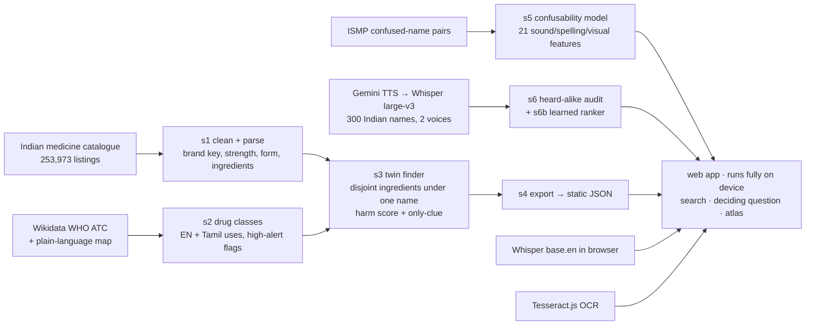

<div align="center">


# Twinpill

### One name. Two medicines. Caught.

**In India, one medicine name can mean two completely different drugs.**
Type, say or photograph a name: Twinpill shows every medicine it could be, and the one question that tells them apart.

[**Live app**](https://hannielvinu.github.io/TwinPill/) · [Twin Atlas](https://hannielvinu.github.io/TwinPill/#/atlas) · [Evidence](https://hannielvinu.github.io/TwinPill/#/evidence) · [Technical report](docs/REPORT.md)

</div>

---

## The problem in one line

**Acetam 650** is a paracetamol fever tablet. **Acetam 500** is levetiracetam, an epilepsy drug. Same name, two companies, both in the Indian catalogue. The only clue on the strip is one number.

India has no database of medicine brand names ([Lancet Regional Health – Southeast Asia, 2024](https://doaj.org/article/356f0b1c9fd84768a6350339f5a8ae45)). Most prescriptions are handwritten lists of brand names, and the Drugs Technical Advisory Board recommended banning different drugs under one name in January 2024. In July 2026 CDSCO opened a public consultation on brand-name extensions, and commentators note that it covers identical names only, not sound-alike or look-alike names ([SpicyIP, 2026](https://spicyip.com/2026/07/brand-name-extensions-by-pharma-may-finally-be-receiving-scrutiny.html); [Medical Dialogues](https://medicaldialogues.in/news/industry/pharma/cdsco/cdsco-examines-use-of-similar-pharma-brand-names-for-different-medicines-seeks-stakeholder-feedback-174507)).

**Who it is for:** pharmacists reading brand-only prescriptions, family members reading a name over the phone, elders ordering refills by voice, and e-pharmacies and hospitals that need a name-safety check.

## What we found (measured on 242,924 Indian listings)

| Finding | Count |
|---|---|
| Brand names used by **different companies** for medicines with **no shared ingredient** | **3,449** |
| Names one company reuses for unrelated medicines via suffixes (Medzole / Medzole-DSR style) | **2,977** |
| Twin names involving a **high-alert** medicine (sedatives, epilepsy, diabetes, opioids, blood thinners, cancer) | **588** |
| High-alert twins where the **printed number is the only clue** | **304** |
| Share of brand names used by 2+ companies that hide a cross-company twin | **42.0%** |

Real examples from the catalogue (click any of them in the app):

| Name | Meaning 1 | Meaning 2 | The only clue |
|---|---|---|---|
| **Acetam** | 650 mg · paracetamol (fever) | 500 mg · levetiracetam (epilepsy) | the number |
| **Adnil** | 5 mg · glibenclamide (diabetes) | 0.5 mg · clonazepam (sedative) | the number |
| **Olip** | eye drop · olopatadine (allergy) | tablet · olanzapine (antipsychotic) | the form |
| **Biopam** | tablet · clonazepam (sedative) | injection · pralidoxime (pesticide-poisoning antidote) | the form |
| **Zentra 100** | capsule SR · opioid painkiller | capsule · antifungal | the company name (and the letters "SR") |
| **Dolo** | Dolo 650 · paracetamol | Dolo Soft MR · nimesulide + tizanidine (other company) | the letters after the name |

## What Twinpill does

1. **Type, say or snap** a medicine name. Speech (Whisper) and photo reading (Tesseract) run **on the device**; nothing leaves the phone.
2. Twinpill finds the brand, **plus every name a listener, a speech app or a hurried reader could land on instead**.
3. It groups everything sold under that name by active ingredient, in plain words ("fits (epilepsy)", not "antiepileptic"), in **English or Tamil**.
4. It asks **the one question that splits the unrelated medicines**: the form, then the printed number, then the letters after the name, then the company. Tap the answer that matches the strip and the right medicine lights up.
5. The **Twin Atlas** ranks India's most dangerous name clashes for pharmacists, hospitals and the regulator.

Twinpill never names the "right" drug. It shows what a name could mean so a person asks before they swallow.

## Why this is new

| Existing approach | What it does | What it misses |
|---|---|---|
| FDA POCA (USA) | Scores two US names you already have, for approving new names | No Indian brands; does not answer "what could this name be?" |
| E-pharmacy search (1mg, PharmEasy…) | Shows the product you clicked | Never warns that the name has an unrelated twin |
| CDSCO consultation (Jul 2026) | Asks about identical brand-name extensions | Sound-alikes, look-alikes and speech mishearings |
| Hospital LASA lists | Hand-made lists of a few dozen pairs | Not the 120,000+ Indian brand names |
| **Twinpill** | Every Indian brand name, all four clash types (same name, same family, sounds alike, misheard by speech AI), plus the single deciding question, offline, in Tamil | – |

## Architecture



**Stack:** Python (pandas, scikit-learn, LightGBM, rapidfuzz, jellyfish, matplotlib) for the pipeline; vanilla JavaScript, Transformers.js and Tesseract.js for the app; static hosting on GitHub Pages. No server, no account, no tracking.

## AI / ML methods

- **Brand-key extraction:** the name a person would actually say ("New Triglucored", not "New"), using word-frequency filtering of generic first words.
- **Ingredient → class:** 1,643 ingredients mapped to WHO ATC codes via Wikidata plus a curated gap list (99.0% of products covered), then to plain-language uses in English and Tamil.
- **Twin detection + harm score:** two products under one brand key with no shared ingredient. A truncation guard excludes products whose ingredient list may be incomplete, so every reported twin is checkable. A transparent 0–100 harm score adds points for a different purpose, a different body system, a high-alert medicine, the same route and form, and the same printed strength.
- **Indian-English phonetic key:** collapses spellings that sound identical at a chemist counter (ph/f, c/k/s, z/s/j, v/w, aspirated pairs, vowel drift). Identical in Python and JavaScript, and tested.
- **Confusability model:** logistic regression over 21 sound, spelling and handwriting features. It is trained on 440 real confused pairs from the ISMP List of Confused Drug Names against 1,320 never-reported pairs, and validated with name-grouped 5-fold cross-validation.
- **Heard-alike audit + learned ranker:** 300 Indian brand names are spoken by two synthetic voices and transcribed by Whisper large-v3. A ranker learns to recover the intended name from what speech AI wrote. It is trained on one voice and tested on the other.
- **Deciding question:** chooses the first attribute (form → number → letters after the name → company) whose values do not overlap between the unrelated meanings.

## Results

See the live [Evidence page](https://hannielvinu.github.io/TwinPill/#/evidence) and [`results/metrics.json`](results/metrics.json).

**1. Which name pairs get confused?** (held-out ISMP pairs, no name shared between train and test)

| Method | ROC-AUC | PR-AUC | Recall at 90% precision |
|---|---|---|---|
| Edit distance (what fuzzy search uses) | 0.906 | 0.801 | 43.6% |
| POCA-style sound + spelling score | 0.911 | 0.814 | 37.0% |
| Gradient boosting, 21 features | 0.922 | 0.838 | 49.1% |
| **Twinpill model** | **0.929** | **0.848** | **57.5%** |

PR-AUC 95% bootstrap CI: Twinpill 0.815–0.876 vs edit distance 0.768–0.833.

**2. Heard-alike: what speech AI does to Indian medicine names.** 300 brand names (the 150 most dangerous twins plus 150 random common names) were spoken by 2 synthetic voices (600 utterances) and transcribed by Whisper large-v3.

- Speech AI spelled only **48.8%** of the names exactly right.
- **7.0%** of transcripts were a *different real Indian brand*. For example: allpride → alpride, onex → onyx, claz → clas, lozin → lozen, roze → rose, sandon → sandin.

| Recovering the intended name from the transcript | Top-1 | Top-3 |
|---|---|---|
| Exact-match search | 48.8% | 48.8% |
| Fuzzy spelling + sound rule | 65.8% | 76.2% |
| **Twinpill learned ranker** (trained on one voice, tested on the other) | **75.5%** | **89.0%** |


**Does one question separate the twins?** For all 6,022 twin names: 1,909 are settled by the form, 863 by the printed number, and 1,831 by the letters after the name, so **76.4% are settled without needing the company name**. The rest are flagged plainly as "only the company name tells them apart".

**App checks:** 9/9 end-to-end browser checks pass (`tests/e2e_app.cjs`): known twins, a misheard name, a no-twin brand, an unknown name (shown as not found, never guessed) and a generic name, with no page errors. The median lookup takes **49 ms** on the device (p95 68 ms). 9 unit tests cover parsing and Python↔JavaScript parity of the phonetic key and the ranker.

## Run it

```bash
pip install -r requirements.txt
make all          # data → model → evaluation → tests  (about 3 minutes on a laptop)
make serve        # open http://localhost:8000
node tests/e2e_app.cjs http://localhost:8000/
```

`make heard` re-runs the speech audit (it needs Gemini TTS and Groq Whisper access). Its audio and transcripts are cached in `data/processed/heard/`, so the results above reproduce without it.

```
pipeline/   s1_products → s2_classes → s3_twins → s4_export → s5_confusability → s6_heard_alike → s6b_ranker → s7_evaluate
web/        the app (index.html, js/, css/, data/)  - deployed as-is to GitHub Pages
results/    metrics.json, plots, per-utterance audit CSV, e2e timings
tests/      pytest (parsing, phonetic parity Python↔JS, search logic) + Playwright end-to-end
docs/       technical report
```

## Impact and deployment

- **Zero cost per lookup.** A static site that works offline after the first load, on any phone browser, with nothing to install.
- **Fits real workflows.** A pharmacist checks a brand-only prescription in seconds. A caregiver checks before reading a name over the phone. An e-pharmacy can call the same twin list at search time. Hospitals can generate their LASA list from the atlas.
- **Regulatory use.** The atlas is ready-made evidence for CDSCO's brand-name consultation, and it extends that consultation from identical names to sound-alikes and speech mishearings.
- **Next steps:** refresh from a current catalogue, add Hindi, Kannada and Malayalam, add a pharmacist-validated harm label set, and add a WhatsApp voice-note front end.

## Limits we state openly

- The catalogue is a public snapshot from around 2021–22. Some products have changed since, and some published cases (Linamac, Medzole) are not in it, so the counts describe that snapshot.
- The source lists at most two ingredients per product. 8,863 products that may be missing one are never used to declare a twin: either the name prints more doses than listed ingredients, or a brand-family product lacks the family's parent molecule (e.g. Telma-MCT, which in reality also contains telmisartan). The twin counts are therefore conservative.
- The heard-alike audit uses synthetic voices. Recordings of real Indian and Tamil-accented speakers are the next validation step.
- The harm score is a transparent rule, not a clinical outcome model.
- Twinpill is not medical advice and never recommends a medicine.

## Original work and third-party disclosure

**Built for Data Sprint 2.0:** the data pipeline, brand-key method, twin detection and harm score, Indian-English phonetic key, confusability model and features, heard-alike audit and learned ranker, deciding-question logic, Tamil plain-language labels, the web app and the evaluation suite.

**Used, not built:**
- Indian medicine catalogue ([junioralive/Indian-Medicine-Dataset](https://github.com/junioralive/Indian-Medicine-Dataset)), downloaded at build time and not redistributed.
- WHO ATC codes via [Wikidata](https://www.wikidata.org) (CC0).
- [ISMP List of Confused Drug Names](https://online.ecri.org/hubfs/ISMP/Resources/ISMP_ConfusedDrugNames.pdf), used to label training pairs.
- Open-source libraries: pandas, scikit-learn, LightGBM, rapidfuzz, jellyfish, wordfreq, matplotlib, [Transformers.js](https://github.com/huggingface/transformers.js) with OpenAI Whisper base.en weights, and [Tesseract.js](https://github.com/naptha/tesseract.js).
- Gemini TTS and Groq-hosted Whisper large-v3, used only offline for the audit.
- Fonts: Poppins, Inter and Noto Sans Tamil (Google Fonts).

MIT licence for the code.
